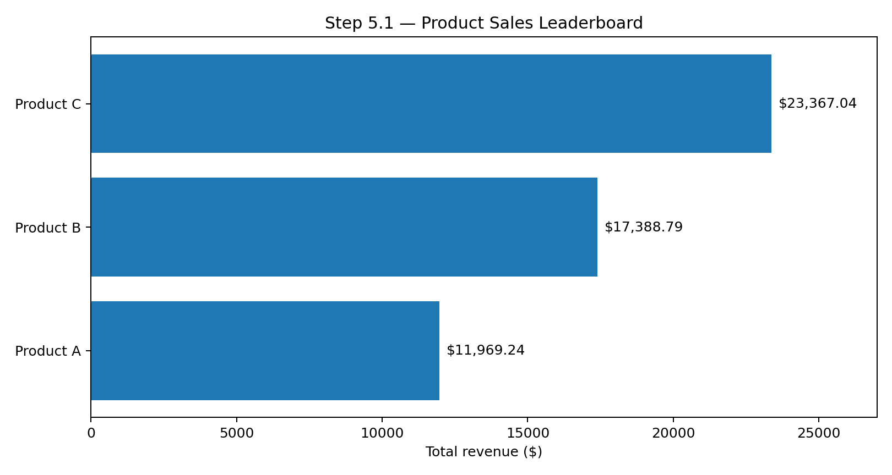
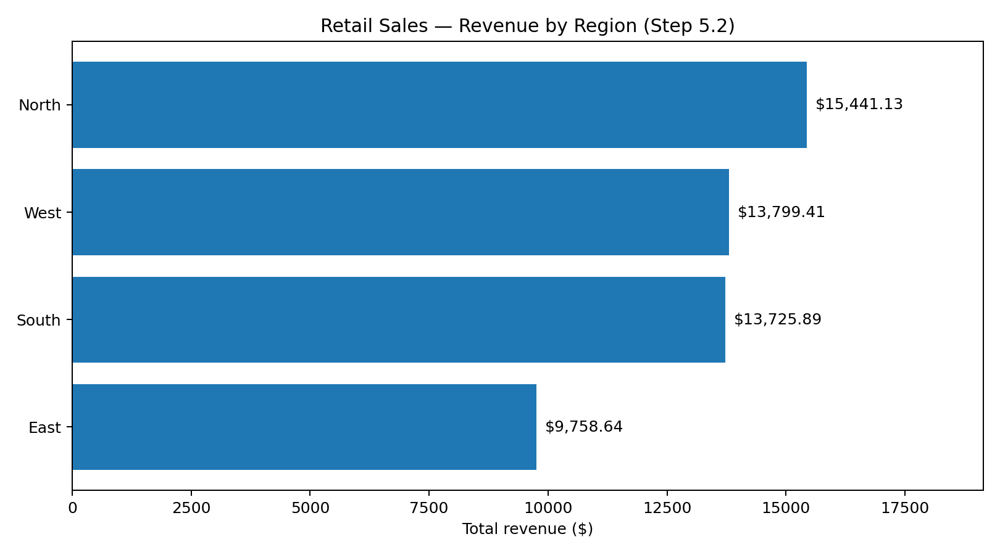
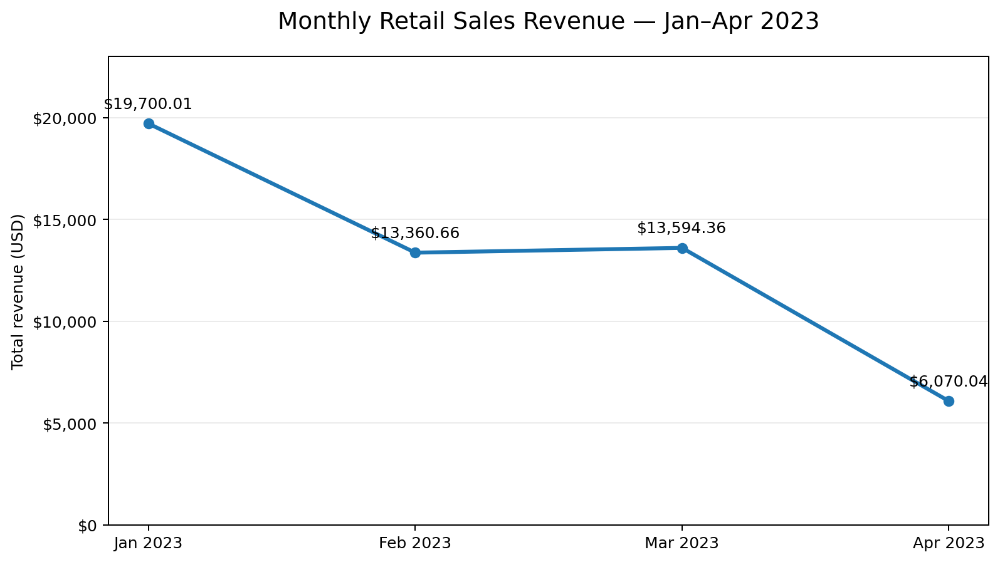
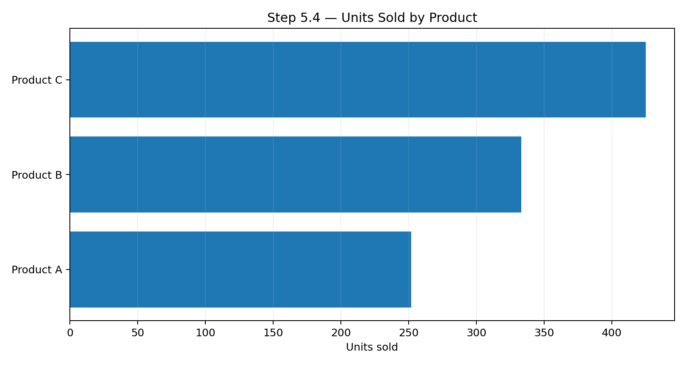
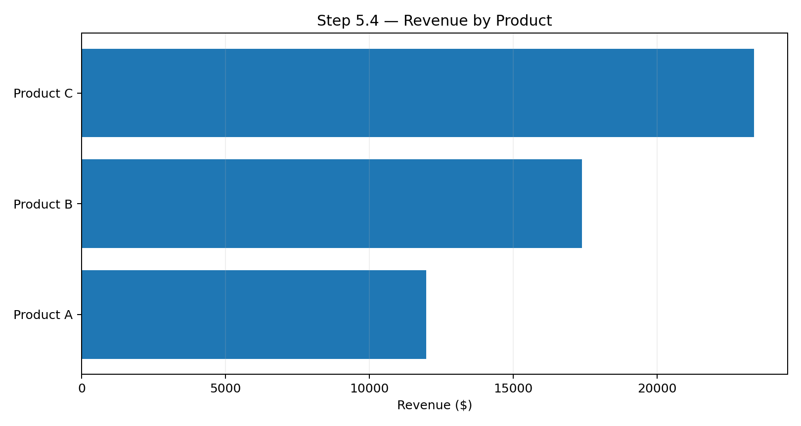
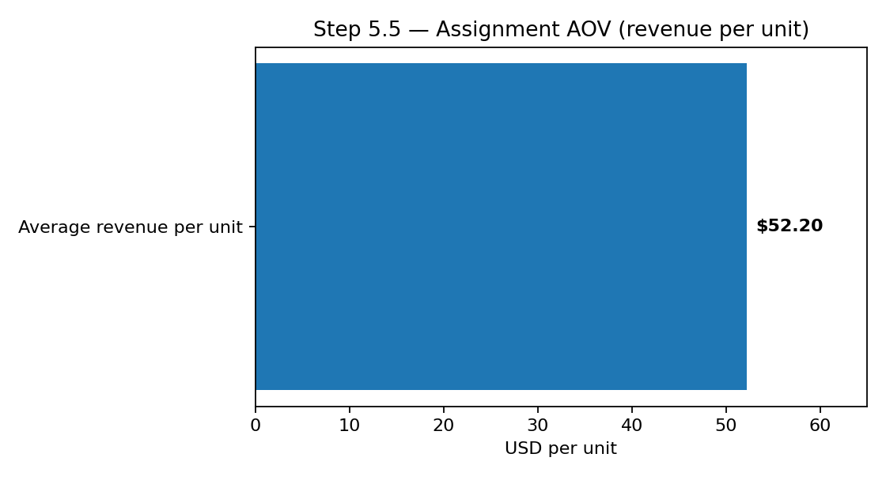
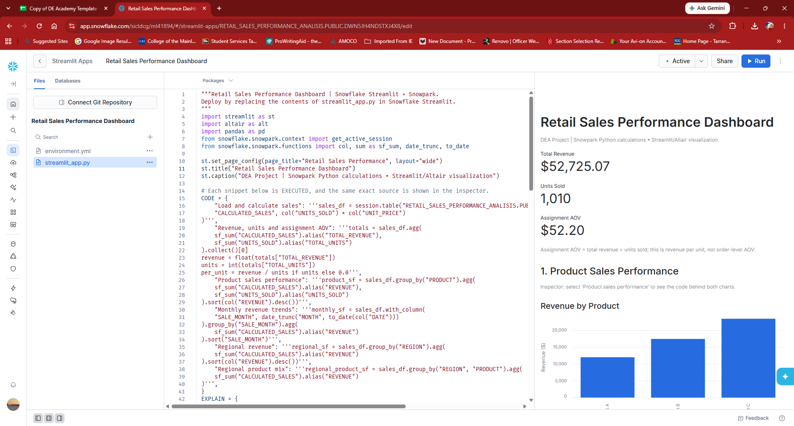

# Retail Sales Performance Analysis — Analysis & Findings

## Step 5: Define and Calculate Metrics

### 5.1 Product Sales Leaderboard — Verified

**Goal:** Identify which products generate the highest revenue, to inform inventory and marketing prioritization.

| Rank | Product | Total revenue |
|---:|---|---:|
| 1 | Product C | $23,367.04 |
| 2 | Product B | $17,388.79 |
| 3 | Product A | $11,969.24 |
| | **Total** | **$52,725.07** |

**Finding:** Product C generated the highest revenue, followed by Product B and Product A. This suggests prioritizing Product C for further inventory and promotional evaluation, but revenue alone cannot establish margin, profitability, or causation.

*Figure 1. Total revenue by product, based on Snowpark results.*

**Data:** [Product revenue CSV](Data/step_5_1_product_revenue.csv)

### 5.2 Regional Sales Comparison — Verified

**Goal:** Compare regional revenue to identify stronger and weaker geographic markets.

| Rank | Region | Total revenue | Share of total |
|---:|---|---:|---:|
| 1 | North | $15,441.13 | 29.3% |
| 2 | West | $13,799.41 | 26.2% |
| 3 | South | $13,725.89 | 26.0% |
| 4 | East | $9,758.64 | 18.5% |
| | **Total** | **$52,725.07** | **100%** |

**Finding:** North is the highest-revenue region ($15,441.13); East is lowest ($9,758.64). Regional differences warrant investigation of product mix, unit volumes, and prices. Revenue alone does not establish regional profitability or the causes of differences.

*Figure 2. Total revenue by region, calculated with Snowpark.*

**Data:** [Regional revenue CSV](Data/step_5_2_regional_revenue.csv)

### 5.3 Monthly Trend Analysis — Verified

**Goal:** Identify changes in monthly retail sales revenue.

| Month | Total revenue |
|---|---:|
| January 2023 | $19,700.01 |
| February 2023 | $13,360.66 |
| March 2023 | $13,594.36 |
| April 2023 | $6,070.04 |
| **Total** | **$52,725.07** |

**Finding:** January generated the most revenue; April the least. Revenue fell from January to February, recovered slightly in March, then declined in April. **Caution:** The available screenshot does not establish whether April is a complete month or whether transaction coverage is consistent, so this is not sufficient evidence of seasonality or underlying demand decline. Only four months are present.

*Figure 3. Monthly revenue from the verified Snowpark output.*

**Data:** [Monthly revenue CSV](Data/step_5_3_monthly_revenue.csv)

### 5.4 Units Sold vs Revenue — Verified

**Goal:** Compare unit sales volume with revenue generated by each product.

| Product | Units sold | Total revenue | Revenue per unit |
|---|---:|---:|---:|
| Product C | 425 | $23,367.04 | $54.98 |
| Product B | 333 | $17,388.79 | $52.22 |
| Product A | 252 | $11,969.24 | $47.50 |
| **Total** | **1,010** | **$52,725.07** | **$52.20** |

**Finding:** Product C leads in both units sold and revenue. Product A ranks lowest in both. Product C also has the highest realized revenue per unit. This is not a profit-margin comparison because costs are unavailable.

*Figure 4. Units sold by product, using verified Snowpark results.*

*Figure 5. Revenue by product, using verified Snowpark results.*

**Data:** [Units vs revenue CSV](Data/step_5_4_units_vs_revenue.csv)

### 5.5 Average Order Value (assignment definition) — Verified

**Goal:** Compute the assignment-defined AOV as total revenue divided by total units sold.

| Metric | Verified value |
|---|---:|
| Total revenue | $52,725.07 |
| Total units sold | 1,010 |
| **Assignment AOV** | **$52.20** |

**Calculation:** $52,725.07 / 1,010 = $52.2030396... ≈ **$52.20 per unit**.

**Finding:** Across the available 100 sales records, each unit sold generated an average of $52.20 in revenue. This is a unit-weighted average, not an order-level average or a profit measure. Because the dataset lacks transaction IDs, conventional average order value cannot be reliably determined.

*Figure 6. Average revenue per unit, calculated using Snowpark.*

**Data:** [AOV metrics CSV](Data/step_5_5_aov_metrics.csv)

**Step 5 status:** All five required metrics have been calculated and verified from notebook output. Further data coverage and completeness checks may still be useful before business recommendations.

### AI assistance disclosure
AI assisted with Snowpark code examples, documentation, and chart creation. The numerical findings above were verified from the user's executed Snowflake notebook screenshots.

## Step 6 — Dashboard implementation

The Streamlit dashboard code is prepared in `retail_sales_streamlit.py` for the three required assignment sections: product performance, monthly trends, and regional insights. The dashboard supports product and region filtering and shows the Step 5 KPIs. The dashboard was successfully executed in Snowflake on October 10, 2026. Its opening KPIs and product revenue chart were verified in the supplied screenshot; other charts and the Code Inspector were reported completed by the project owner but were not individually screenshot-verified here.

*Figure 7. Live Snowflake Streamlit dashboard displaying verified KPIs and product revenue chart.*

**Interpretation warning:** April 2023 contains transactions only through April 10, so its raw revenue total is not comparable to a complete month. The assignment's AOV formula is revenue per unit, not transaction-level AOV.
