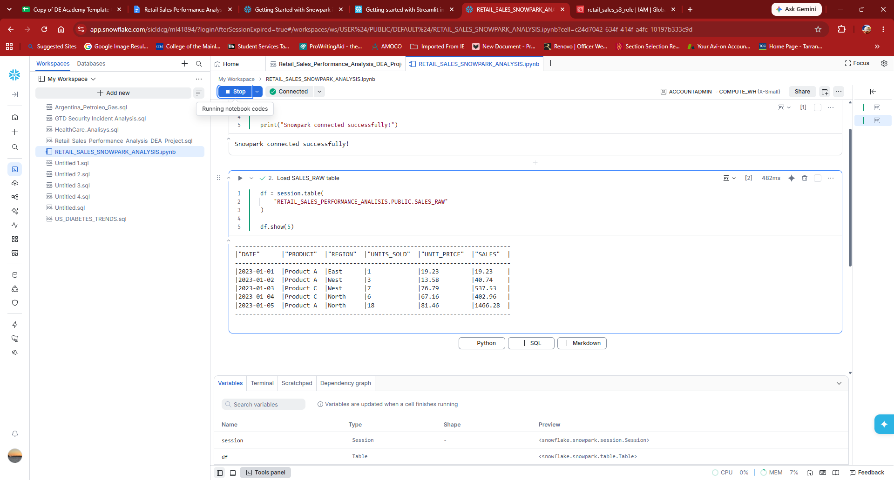
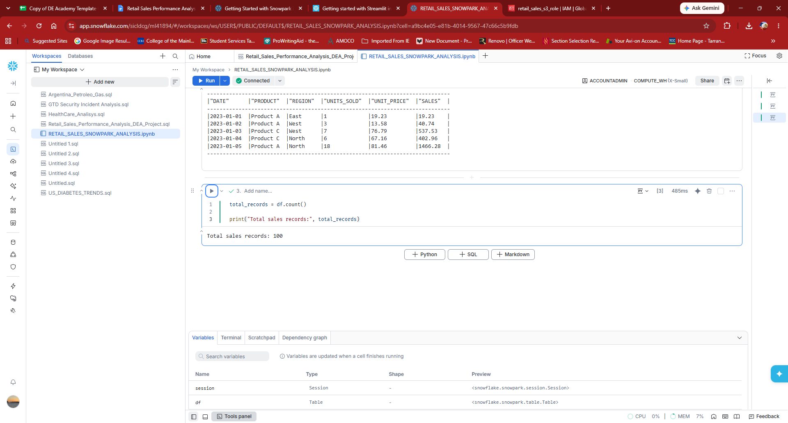
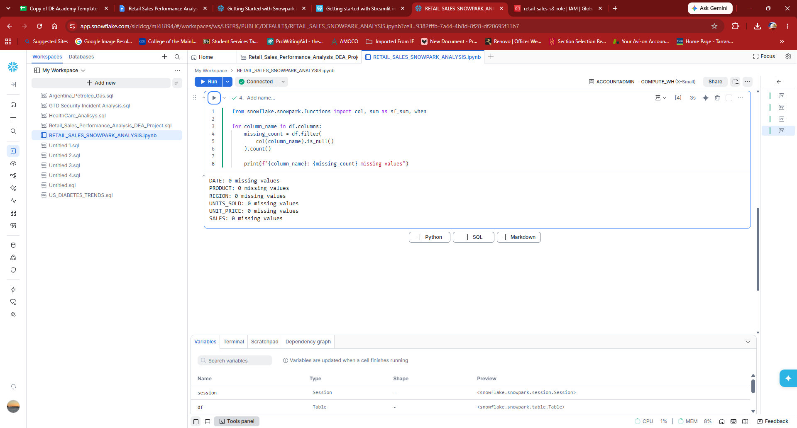
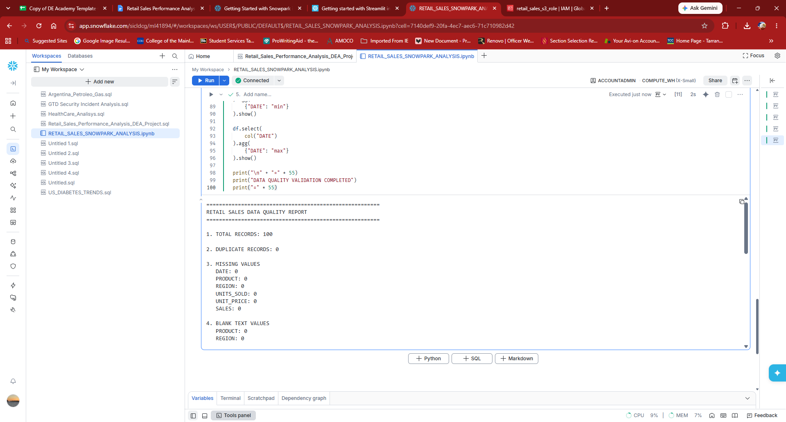
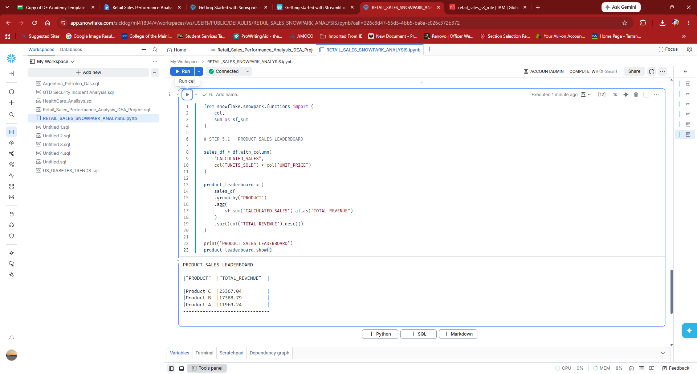
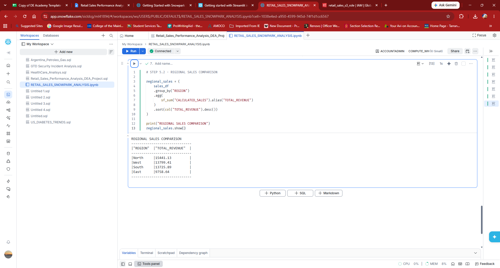
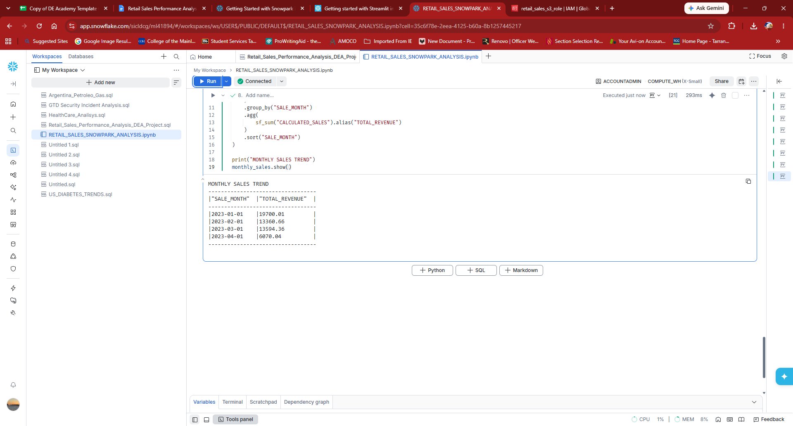
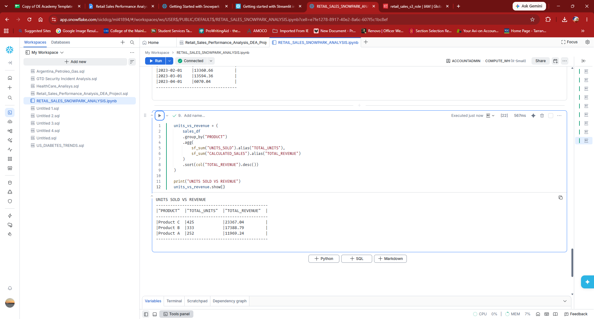
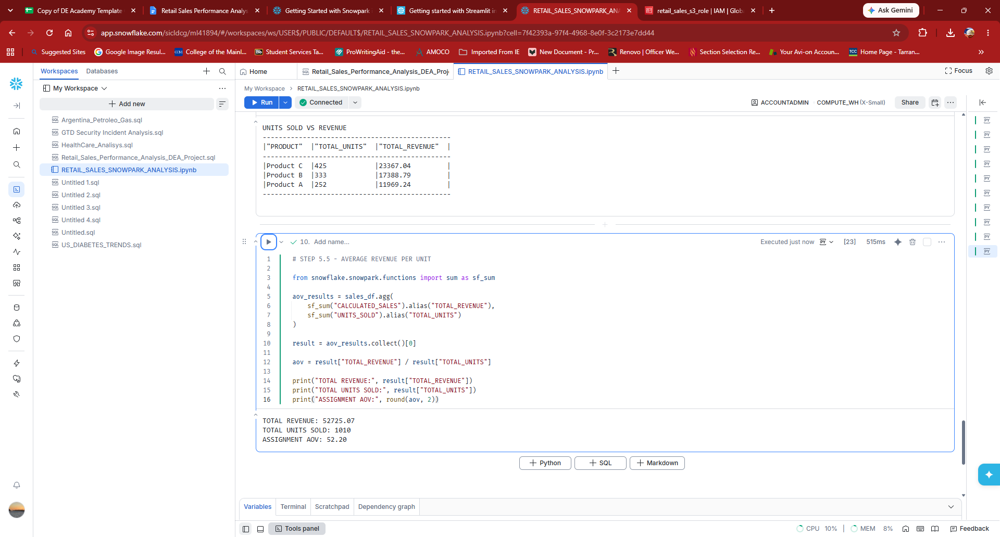

# Retail Sales Performance Analysis — Technical Documentation

## Snowpark for Python: successful connection and data retrieval

**Status:** Verified successful from the Snowflake notebook screenshot (October 9, 2026, Pacific time).

The Snowflake notebook `RETAIL_SALES_SNOWPARK_ANALYSIS.ipynb` successfully initialized a Snowpark session and read records from the retail sales table. The notebook displayed **"Snowpark connected successfully!"** and returned five sales records from `SALES_RAW`.

**Environment visible in the screenshot:**

- Platform: Snowflake Notebooks
- Notebook: `RETAIL_SALES_SNOWPARK_ANALYSIS.ipynb`
- Active role: `ACCOUNTADMIN`
- Warehouse: `COMPUTE_WH` (X-Small)
- Source table: `RETAIL_SALES_PERFORMANCE_ANALYSIS.PUBLIC.SALES_RAW`
- Data preview: five records, with columns `DATE`, `PRODUCT`, `REGION`, `UNITS_SOLD`, `UNIT_PRICE`, and `SALES`

### Python / Snowpark verification

```python
from snowflake.snowpark.context import get_active_session

session = get_active_session()
print("Snowpark connected successfully!")

# Read the existing Snowflake sales table as a Snowpark DataFrame.
df = session.table(
    "RETAIL_SALES_PERFORMANCE_ANALYSIS.PUBLIC.SALES_RAW"
)
df.show(5)
```

**Observed outcome:** The session test printed the success message, and the table query displayed five rows. This verifies Snowpark connectivity and read access to the table. The record-count operation was subsequently executed and verified as documented below.

### Screenshot evidence



*Figure 1. Snowflake notebook successfully connected with Snowpark and displayed the first five sales records.*


## Snowpark for Python: record-count validation (Step 9)

**Status:** Passed — verified from the Snowflake notebook screenshot (October 9, 2026, Pacific time).

After creating the Snowpark DataFrame `df` from `RETAIL_SALES_PERFORMANCE_ANALYSIS.PUBLIC.SALES_RAW`, the notebook ran:

```python
total_records = df.count()
print("Total sales records:", total_records)
```

**Observed notebook output:**

```text
Total sales records: 100
```

**Interpretation:** Snowpark counted **100 rows** in the `SALES_RAW` table, matching the previously observed **100 records** in the staged CSV. This confirms that the Snowpark DataFrame can execute an aggregate row count against the Snowflake table. Matching counts do not, by themselves, establish row-by-row equality or full data-quality validity.

### Screenshot evidence — record count



*Figure 2. Snowflake notebook cell executing `df.count()` and printing `Total sales records: 100`.*


## Snowpark for Python: SQL NULL validation (Step 10)

**Status:** Passed — verified from the Snowflake notebook screenshot (October 9, 2026, Pacific time).

The existing `df` Snowpark DataFrame was checked column by column for SQL NULL values.

```python
from snowflake.snowpark.functions import col, sum as sf_sum, when

for column_name in df.columns:
    missing_count = df.filter(
        col(column_name).is_null()
    ).count()

    print(f"{column_name}: {missing_count} missing values")
```

**Observed notebook output:**

```text
DATE: 0 missing values
PRODUCT: 0 missing values
REGION: 0 missing values
UNITS_SOLD: 0 missing values
UNIT_PRICE: 0 missing values
SALES: 0 missing values
```

**Interpretation:** All six columns in the Snowflake `SALES_RAW` table returned **zero SQL NULL values**, consistent with the earlier stage-level NULL checks. This operation does **not** check whitespace-only strings, placeholder text, invalid data types, or other forms of missingness. The imported `sf_sum` and `when` functions were not used in this cell.

### Screenshot evidence — SQL NULL check



*Figure 3. Snowflake notebook showing the executed Snowpark NULL-check loop and zero missing values for each of six columns.*

### Technical notes

The initial table read had produced a database-access error. The subsequent screenshot confirms that the same table reference executed successfully. The exact cause of the earlier error was not established, so no root cause is asserted here.

The dataset was previously validated through the Snowflake external stage. Recorded checks: 100 staged CSV records, zero SQL NULL values, zero blank fields, zero exact duplicate records, and zero incorrect sales calculations using a $0.01 tolerance. Data-type validation results remain unconfirmed.

### AI assistance disclosure

AI assistance was used to help explain Snowpark concepts, draft notebook examples, and prepare this technical documentation. Execution results and screenshot evidence were supplied from the project owner's Snowflake environment.


## Snowpark for Python: consolidated data-quality validation (Step 11)

**Status:** Script executed successfully; screenshot provides **partial result evidence** (October 9, 2026, Pacific time).

A consolidated Snowpark Python notebook cell ran a sequence of checks against the existing `df` DataFrame from `SALES_RAW`: record count, exact-row duplicates, SQL NULLs, blank `PRODUCT`/`REGION` values, parseable dates and numeric fields, nonpositive quantities and amounts, sales calculation differences, distinct categories, and date coverage. The screenshot shows the cell completed without a displayed error, but only the top of the output is visible.

### Confirmed results visible in screenshot

| Check | Observed result |
| --- | --- |
| Total rows | 100 |
| Exact duplicate rows (`df.count() - df.distinct().count()`) | 0 |
| SQL NULLs: `DATE`, `PRODUCT`, `REGION`, `UNITS_SOLD`, `UNIT_PRICE`, `SALES` | 0 each |
| Blank strings after trimming: `PRODUCT`, `REGION` | 0 each |

**Not yet verified from screenshot:** invalid dates, invalid numeric values, zero/negative numeric values, mismatched sales calculations, product and region category counts, and minimum/maximum dates. These should be recorded only after the remaining output is provided.

### Screenshot evidence — consolidated checks



*Figure 4. Snowflake notebook shows the consolidated validation cell successfully executed and the first four test groups.*

**Interpretation:** The visible tests are consistent with earlier stage-level checks, but do not prove all tests in the consolidated report passed. These are read-only validation queries; no source data changes are shown.


## Step 5.1 — Product Sales Leaderboard (verified)

Snowpark calculated row revenue from `UNITS_SOLD * UNIT_PRICE`, grouped by `PRODUCT`, summed the calculated sales, and sorted descending. The notebook successfully returned Product C $23,367.04; Product B $17,388.79; Product A $11,969.24.

```python
from snowflake.snowpark.functions import col, sum as sf_sum
sales_df = df.with_column("CALCULATED_SALES", col("UNITS_SOLD") * col("UNIT_PRICE"))
product_leaderboard = (
    sales_df.group_by("PRODUCT")
    .agg(sf_sum("CALCULATED_SALES").alias("TOTAL_REVENUE"))
    .sort(col("TOTAL_REVENUE").desc())
)
product_leaderboard.show()
```



*Figure 5. Successful Step 5.1 notebook execution and product revenue results.*


*Figure 6. Product revenue comparison derived from verified notebook output.*


## Step 5.2 — Regional Sales Comparison (verified)

**Status:** Passed. The user's Snowflake notebook screenshot shows the following Snowpark Python code executed and returned four regions, sorted by revenue descending.

```python
regional_sales = (
    sales_df
    .group_by("REGION")
    .agg(sf_sum("CALCULATED_SALES").alias("TOTAL_REVENUE"))
    .sort(col("TOTAL_REVENUE").desc())
)
print("REGIONAL SALES COMPARISON")
regional_sales.show()
```

**Verified output:** North $15,441.13; West $13,799.41; South $13,725.89; East $9,758.64. Total across regions: $52,725.07, matching the sum of product revenues in Step 5.1.



*Figure 7. Snowflake notebook showing the successful regional aggregation and returned results.*


*Figure 8. Regional revenue chart generated from verified Snowpark output.*

**AI assistance:** AI helped draft Snowpark code, documentation, and visualizations. The executed query results were supplied by the project owner.


## Step 5.3 — Monthly Trend Analysis (verified)

**Status:** Passed. The user's Snowflake notebook screenshot shows a successful monthly grouping and four monthly revenue results.

```python
from snowflake.snowpark.functions import to_date, date_trunc

monthly_sales = (
    sales_df
    .with_column("SALE_MONTH", date_trunc("MONTH", to_date(col("DATE"))))
    .group_by("SALE_MONTH")
    .agg(sf_sum("CALCULATED_SALES").alias("TOTAL_REVENUE"))
    .sort("SALE_MONTH")
)
print("MONTHLY SALES TREND")
monthly_sales.show()
```

**Verified output:** January 2023 $19,700.01; February $13,360.66; March $13,594.36; April $6,070.04. Sum: $52,725.07, consistent with the product and regional aggregations.



*Figure 9. Snowflake notebook showing the Step 5.3 monthly grouping and output.*


*Figure 10. Monthly sales revenue plotted from the verified notebook output.*

**Validation note:** Month completeness and date coverage were not confirmed in this screenshot. Do not infer seasonality from only four months.


## Step 5.4 — Units Sold vs Revenue (verified)

**Status:** Passed. Snowpark grouped the sales DataFrame by product and calculated units and revenue using Snowflake-side aggregations.

```python
units_vs_revenue = (
    sales_df
    .group_by("PRODUCT")
    .agg(
        sf_sum("UNITS_SOLD").alias("TOTAL_UNITS"),
        sf_sum("CALCULATED_SALES").alias("TOTAL_REVENUE")
    )
    .sort(col("TOTAL_REVENUE").desc())
)
print("UNITS SOLD VS REVENUE")
units_vs_revenue.show()
```

**Verified output:** Product C: 425 units, $23,367.04; Product B: 333 units, $17,388.79; Product A: 252 units, $11,969.24. Totals: 1,010 units and $52,725.07. The total revenue reconciles to Steps 5.1–5.3.



*Figure 11. Snowflake notebook execution and results for units sold versus revenue.*


**Interpretation caveat:** Revenue per unit is not profit margin; cost data is not present. AI assisted with documentation and chart preparation; executed results were provided by the project owner.


## Step 5.5 — Average Order Value (assignment definition, verified)

**Status:** Passed. The user's executed Snowflake notebook screenshot confirms total revenue **$52,725.07**, total units **1,010**, and assignment AOV **$52.20**.

```python
# STEP 5.5 - AVERAGE REVENUE PER UNIT
from snowflake.snowpark.functions import sum as sf_sum

aov_results = sales_df.agg(
    sf_sum("CALCULATED_SALES").alias("TOTAL_REVENUE"),
    sf_sum("UNITS_SOLD").alias("TOTAL_UNITS")
)
result = aov_results.collect()[0]
aov = result["TOTAL_REVENUE"] / result["TOTAL_UNITS"]
print("TOTAL REVENUE:", result["TOTAL_REVENUE"])
print("TOTAL UNITS SOLD:", result["TOTAL_UNITS"])
print("ASSIGNMENT AOV:", round(aov, 2))
```

**Verified output:** `TOTAL REVENUE: 52725.07`, `TOTAL UNITS SOLD: 1010`, `ASSIGNMENT AOV: 52.20`. The code aggregates values in Snowflake using Snowpark and collects only the single aggregate row for final Python division. A production implementation should explicitly guard against a zero-unit denominator and handle exceptions.



*Figure 12. Snowflake notebook showing executed code and results for Step 5.5.*


**Terminology caveat:** The assignment calls revenue divided by units sold “AOV.â€